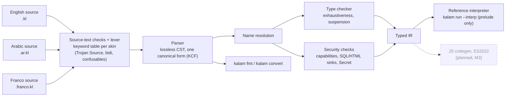

# Kalam (كلام)

**A statically typed language for full-stack web and SaaS, written in English, Arabic or Egyptian Franco.**

⭐ **If a programming language you can write in Arabic, English or Franco interests you, please star the repo.** It is the clearest signal that this is worth building.

> **Status: pre-alpha front end (November 2026).** The compiler checks and interprets Kalam today. It does **not** produce JavaScript yet, so you cannot build or deploy an app with it. Details in [Status](#status).

Kalam is for professional developers, MENA first. It compiles to JavaScript first (C/WASM later), uses indentation for blocks, infers types, and is secure by default:

- **SQL injection and XSS are type errors.** `sql"…"` and `html"…"` are checked tagged literals, not strings.
- **Routes are deny-by-default.** Every route must state who can access it.
- **I/O needs capabilities.** Code can touch the network or the disk only when it is handed the right value.
- **No `null`, no exceptions, no `async`.** Kalam uses `Option`, `Result` with `?`, and `panic` for bugs. Suspension is inferred.

Every file is written in one **skin**: English (`.kl`), Arabic (`.ar.kl`) or Egyptian Franco (`.franco.kl`). All three parse to the same canonical form, so `kalam convert` translates between them losslessly.

## كلام

<div dir="rtl">

**لغة برمجة ذات أنواع ثابتة لبناء تطبيقات الويب والبرمجيات الخدمية (SaaS) بالكامل، تكتبها بالإنجليزية أو بالعربية أو بالفرانكو المصري.**

> **الحالة: نسخة أولية (نوفمبر 2026).** المترجم يفحص الكود ويتحقق من الأنواع وينفذه بمفسّر مرجعي، لكنه لا يُنتج جافاسكربت بعد، فلا يمكن بناء تطبيق به حتى الآن. التفاصيل في قسم Status بالإنجليزية، وخطة الطريق في ملف ROADMAP.md.

كلام موجهة للمطورين المحترفين، والبداية من منطقة الشرق الأوسط وشمال أفريقيا. تُترجَم أولًا إلى جافاسكربت، وتستخدم المسافات البادئة لتحديد الكتل، وتستنتج الأنواع تلقائيًا، وهي آمنة افتراضيًا:

- **حقن SQL وهجمات XSS أخطاء أنواع** يكتشفها المترجم قبل التشغيل.
- **كل مسار في الخادم مغلق افتراضيًا** حتى تحدد من يحق له الوصول.
- **لا وصول للشبكة أو الملفات** إلا بصلاحية صريحة.
- **لا `null` ولا استثناءات ولا `async`.**

كل ملف يُكتب بـ**واجهة** واحدة: الإنجليزية أو العربية أو الفرانكو. الثلاث تتحول إلى الشكل نفسه، فيمكن التحويل بينها دون أي فقد.

</div>

## Status

Milestones follow [`ROADMAP.md`](ROADMAP.md); each one closes only on its exit gates and a founder sign-off.

| Milestone | State | Evidence |
|---|---|---|
| M0 Spec approved | **Done** | `spec/KALAM-SPEC.md` v0.1, decisions D1–D25 |
| M1 Lexer, parser, formatter, skin converter | **Closed 2026-10-28** | 24.07 h fuzz run, 0 crashes, 95.1M executions (decision D27) |
| M2 Type checker and reference interpreter | **Code-complete, not closed** | Still waiting on its own 24 h fuzz run (now including the type checker), the founder's judge calibration and the eval-integrity sign-off |
| M3 JavaScript emitter, `kalam run`, hello web | Not started | `kalam-emit-js` holds only the backend interface and a source-map encoder |
| M4–M10, Beta, 1.0 | Not started | 1.0 is planned for about Feb–Mar 2029 (decision D25) |

**Works today** (`kalam` binary, built from `compiler/`):
- `kalam check`: source-text security checks (Trojan Source, bidi and invisible characters), lexing in all three skins, parsing, name resolution and full static type checking: records, enums, generics, traits, exhaustive `match`, `Result` and `?`, inferred suspension, capabilities and SQL/HTML sink types. `--json` for editors and agents.
- `kalam fmt`, `kalam convert --to en|ar|franco` (designed to be lossless; the 22 converter bugs the M1 fuzz run found are fixed in M2 code, and the pending M2 fuzz run re-checks them), `kalam fix` (machine-applicable fixes) and `kalam explain` (every diagnostic in English, Arabic and Franco).
- `kalam run --interp`: runs `main` on a reference interpreter, **prelude only** (core types, `print`, `panic`, `assert`).

**Does not work yet:** JavaScript output, `kalam run`/`build`/`new`/`test`, the stdlib beyond the prelude (the rest exists only as type signatures, so code that uses it type-checks but cannot run), the web framework, the LSP, the MCP server and the package manager.

`cargo test --workspace` (in `compiler/`, run 2026-11-17 on Windows 11, rustc 1.99.1, LF checkout): **914 passed, 0 failed, 1 ignored**. On a default Windows checkout (`core.autocrlf=true`) one formatter test, `fmt_is_idempotent_on_the_spec_examples`, fails on CRLF line endings because the repository has no `.gitattributes` yet; clone with `git -c core.autocrlf=false clone …` to avoid it.

## Try it

Needs a Rust toolchain. From the repository root:

```sh
cd compiler
cargo run -q -p kalam-cli -- run --interp ../examples/fizzbuzz.ar.kl
```
```text
1
2
Fizz
4
Buzz
...
```

The English (`fizzbuzz.kl`) and Franco (`fizzbuzz.franco.kl`) files print byte-identical output, and `kalam convert` turns one into the other:

```sh
cargo run -q -p kalam-cli -- convert --to ar ../examples/fizzbuzz.kl    # prints examples/fizzbuzz.ar.kl exactly
```

A type error, with the explanation every Kalam diagnostic carries (set `KALAM_LANG=ar` or `franco` for the same message in Arabic or Franco):

```sh
cargo run -q -p kalam-cli -- check ../examples/type-error.kl
```
```text
-- TYPES DON'T MATCH -------------------------- ../examples/type-error.kl  K0600

The type of this value doesn't fit the place where it is used. Kalam never converts between types by itself, so the two have to agree exactly.

2│     let x: Int = "five"
                    ^^^^^^ expected `Int`, found `String`

Help: Check what this place needs (a parameter, a return type, an annotation, a function to call or something to loop over); the note under the code says which types don't fit. Then change the value, or convert it explicitly, for example with `.to_float()` or `.round()` between number types.

Learn more: kalam explain K0600
```

## How the compiler fits together



Built today: everything except the dashed box. Crate-level design: [`compiler/ARCHITECTURE.md`](compiler/ARCHITECTURE.md).

## One program, three skins

FizzBuzz from spec §28.2. `kalam convert` produces each version from the others; only keywords and core names change, so all three have the same canonical form and print the same output.

<table>
<tr><th>English (<code>fizzbuzz.kl</code>)</th><th>العربية (<code>fizzbuzz.ar.kl</code>)</th><th>Franco (<code>fizzbuzz.franco.kl</code>)</th></tr>
<tr>
<td>

```kalam
fn main():
    for n in 1..=100:
        if n % 15 == 0:
            print("FizzBuzz")
        else if n % 3 == 0:
            print("Fizz")
        else if n % 5 == 0:
            print("Buzz")
        else:
            print("{n}")
```

</td>
<td>

```kalam
دالة رئيسي():
    لكل n في 1..=100:
        إذا n % 15 == 0:
            اطبع("FizzBuzz")
        وإلا إذا n % 3 == 0:
            اطبع("Fizz")
        وإلا إذا n % 5 == 0:
            اطبع("Buzz")
        وإلا:
            اطبع("{n}")
```

</td>
<td>

```kalam
dala ra2isi():
    lekol n fi 1..=100:
        law n % 15 == 0:
            ektb("FizzBuzz")
        walla law n % 3 == 0:
            ektb("Fizz")
        walla law n % 5 == 0:
            ektb("Buzz")
        walla:
            ektb("{n}")
```

</td>
</tr>
</table>

## Hello, world ×3

English (`hello.kl`):

```kalam
fn main():
    print("Hello, world!")
```

العربية (`hello.ar.kl`):

```kalam
دالة رئيسي():
    اطبع("Hello, world!")
```

Franco (`hello.franco.kl`):

```kalam
dala ra2isi():
    ektb("Hello, world!")
```

All three files have the same canonical form (KCF hash). String text is never translated, so the output is identical. GitHub and most Markdown viewers do not apply Kalam's per-token bidi isolation, so the Arabic block may look reordered here. Kalam's own tools display it correctly.

## Toolchain

One Rust binary, `kalam`. `check`, `fmt`, `convert`, `fix`, `explain` and `run --interp` work today; `new`, `run` (on JavaScript) and the rest are planned:

```sh
kalam new myapp                  # new project, with AGENTS.md for AI agents (planned)
kalam run                        # build to JS and run (planned, M3)
kalam fmt                        # the one canonical format
kalam convert --to ar hello.kl   # lossless skin conversion
kalam check --json               # diagnostics for editors and agents
kalam explain K0601              # long explanation, in en / ar / franco
```

## Repository

| Path | Contents |
|---|---|
| [`DECISIONS.md`](DECISIONS.md) | Locked founder decisions |
| [`spec/KALAM-SPEC.md`](spec/KALAM-SPEC.md) | The language specification, v0.1 |
| [`spec/keywords.json`](spec/keywords.json) | Keyword and core-name table for the three skins |
| [`spec/llms.txt`](spec/llms.txt) | Compact guide for LLMs writing Kalam |
| [`ROADMAP.md`](ROADMAP.md) | Milestones M0–M10, Beta and 1.0 |
| [`spec/CRITIQUE.md`](spec/CRITIQUE.md) | Completeness review of the spec and plan, with open issues |
| [`compiler/`](compiler/) | The Rust workspace (lexer, parser, formatter, type checker, interpreter, CLI) and [`ARCHITECTURE.md`](compiler/ARCHITECTURE.md) |
| [`examples/`](examples/) | Small runnable programs used in this README |
| [`eval/`](eval/) | Scorecard, build-loop procedure and test corpus |
| [`docs/DOCS-PLAN.md`](docs/DOCS-PLAN.md) | Documentation site plan |
| [`research/`](research/) | Research reports 01–06 behind the design |

## License

Open-source core, dual-licensed under [MIT](LICENSE-MIT) or [Apache-2.0](LICENSE-APACHE), at your option (decision D9).

---

**Built by [Shady Al-Halawani](https://github.com/Shadysmetools)**, AI Product Manager & Tech Lead · [LinkedIn](https://www.linkedin.com/in/shady-al-halawani-333a5419a) · [Book a call](https://calendly.com/shady-al-halawani)
